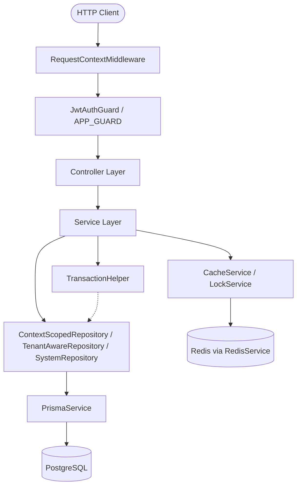

# Architecture: layers, request context, module structure, DI

> Part of the rules contract (sections 1, 2, 14, 15 of the former single `role.md`). Section numbers are kept so existing `role.md §N` references still resolve. Start from `core.md`.

---

## 1. Architectural Overview and Layer Responsibilities

The backend follows a strict unidirectional, layered architectural flow:

```text
HTTP Request
    ↓
RequestContextMiddleware (AsyncLocalStorage initialization)
    ↓
JwtAuthGuard (Authentication & Context Enrichment)
    ↓
Controller (HTTP Binding, Validation, & Response Mapping)
    ↓
Service (Domain Business Logic & Orchestration)
    ↓
Repository (Data Access, Isolation, & Query Encapsulation)
    ↓
Prisma ORM (@prisma/adapter-pg)
    ↓
PostgreSQL Database
```

Each layer has strictly defined boundaries and invariants.



### 1.1 Controllers (`src/modules/<feature>/<feature>.controller.ts`)

Controllers are the HTTP boundary adapters.

#### Controllers MUST:
* Remain thin and focused exclusively on HTTP concerns (routing, status codes, headers, parameter extraction).
* Validate and parse incoming payloads via NestJS DTOs.
* Extract authenticated caller information exclusively using `@CurrentUser()` and `@CurrentInstituteId()` decorators.
* Mark unauthenticated endpoints explicitly with the `@Public()` decorator.
* Delegate all business actions to domain services and return service results.
* Use explicit HTTP status code decorators (e.g., `@HttpCode(HttpStatus.OK)`) for non-201 `POST` endpoints.

#### Controllers MUST NOT:
* Access `PrismaService` or execute database queries directly.
* Contain business logic, calculation, or domain validation rules.
* Implement manual tenant filtering or cross-tenant validation.
* Read or write directly to `AsyncLocalStorage` (`RequestContext`).
* Instantiate services or repositories using `new`.

---

### 1.2 Services (`src/modules/<feature>/<feature>.service.ts`)

Services are the sole orchestrators of business logic and domain invariants.

#### Services MUST:
* Contain all domain validation, state transitions, calculations, and business workflows.
* Perform assertions and validation using `Ensure` and `ErrorMessages`.
* Coordinate between domain repositories and infrastructure services (e.g., `CacheService`, `LockService`, `JwtTokenService`) — never `RedisService` directly (§14.2).
* Execute multi-step atomic operations using `TransactionHelper.executeInTransaction()`.
* Sanitize and map internal entities to safe output structures (e.g., stripping `passwordHash`).
* Reuse existing domain services rather than duplicating queries or business logic.

#### Services MUST NOT:
* Depend on Express `Request` or `Response` objects.
* Execute direct Prisma queries when a repository method exists or should exist.
* Duplicate business validation logic that is already implemented in another domain service.
* Throw raw `new Error(...)` for predictable domain/validation errors (use `Ensure` or NestJS HTTP exceptions).

---

### 1.3 Repositories (`src/modules/<feature>/<feature>.repository.ts`)

Repositories own all data persistence and retrieval logic.

#### Repositories MUST:
* Extend `ContextScopedRepository<T>` for all entities scoped to operational dimensions (`branchId` and/or `academicYearId`), configuring `branchKey` and/or `yearKey`.
* Extend `TenantAwareRepository<T>` for all general institute-wide database models (`instituteId`).
* Extend `SystemRepository<T>` ONLY WHEN explicit cross-tenant access is required by system architecture (e.g., authentication lookup, super-admin maintenance).
* Encapsulate complex Prisma query filters, nested includes, and aggregations.
* Automatically leverage `this.client` to support seamless inclusion inside interactive Prisma transactions.
* Expose intention-revealing, domain-specific query methods (e.g., `findByPhone`, `findByIdWithInstitute`).

#### Repositories MUST NOT:
* Contain business rule validation (business validation belongs in Services).
* Depend on Controllers, HTTP Request/Response objects, or presentation DTOs.
* Accept manual `instituteId` arguments when extending `TenantAwareRepository` or `ContextScopedRepository` (resolved from context).
* Bypass tenant or operational context isolation filters.

---

---

## 2. Request Context (`AsyncLocalStorage`)

Request context isolation is implemented in `src/context/request-context.ts` using Node.js `AsyncLocalStorage`.

```text
Incoming Request (HTTP Headers: Authorization, Accept-Language, X-Client-Type, X-Branch-Id, X-Academic-Year-Id)
       ↓
RequestContextMiddleware
  - Initializes context: { userId: 0, instituteId: 0, role: '', language, clientType, branchId, academicYearId }
  - Parses Accept-Language header (default: 'en')
  - Parses X-Client-Type ('web' | 'mobile')
  - Parses X-Branch-Id (positive integer)
  - Parses X-Academic-Year-Id or X-Year-Id (positive integer)
       ↓
JwtAuthGuard (validates access token → enriches userId, instituteId, role in RequestContext)
       ↓
Application Layers (Controllers, Services, Repositories read RequestContext synchronously & concurrency-safely)
```

### Context Schema (`RequestContextData`)
```ts
import { ClientType } from '../common/types/client-type.enum';

export interface RequestContextData {
  userId: number;
  instituteId: number;
  role: string;
  language: string;
  clientType?: ClientType;
  branchId?: number;
  academicYearId?: number;
}
```

### Rules & Constraints:
1. **Concurrency Safety**: Each asynchronous execution chain has an isolated store. Request data MUST NOT be stored in global variables, static class fields, or singleton service properties.
2. **Lifecycle Flow**:
   - `RequestContextMiddleware` wraps the entire downstream execution inside `RequestContext.run(...)` with initialized headers and default identity tokens.
   - `JwtAuthGuard` mutates the active store in place upon validating the JWT access token, setting `userId`, `instituteId`, and `role`.
3. **Operational Context Headers**:
   - `x-branch-id`: Injects active geographical branch scope for the request.
   - `x-academic-year-id` (or fallback `x-year-id`): Injects active academic year scope for the request.
   - `x-client-type`: Injects client platform (`web` | `mobile`).
   - `accept-language`: Injects user language preference (`ar` | `en`).
4. **Consumption Rules**:
   - Repositories MUST call `RequestContext.getInstituteId()` to retrieve the tenant ID.
   - Repositories extending `ContextScopedRepository` call `RequestContext.getBranchId()` and `RequestContext.getAcademicYearId()` for automatic dimensional filtering.
   - Centralized error formatting MUST call `RequestContext.getLanguage()` to resolve translation strings.
   - Controllers and services MUST NOT pass Express `req` through internal method signatures merely to deliver user, branch, or tenant metadata.
5. **Failure Behavior**: Calling `RequestContext.getInstituteId()` outside an authenticated request context throws an explicit error: `"Institute context is not available. This request may not be authenticated."`

---

---

## 14. Module Structure and Directory Conventions

Modules are organized by functional domain under `src/modules/`:

```text
src/
├── common/                     # Cross-cutting utilities & infrastructure
│   ├── decorators/             # Parameter & method decorators (@CurrentUser, @Roles, @Public)
│   ├── errors/                 # Ensure, ErrorMessages, GlobalExceptionFilter
│   ├── filters/                # FilterBuilder
│   ├── pagination/             # PaginationQueryDto, PaginatedResult
│   └── types/                  # AuthenticatedUser, UserRole enum, common interfaces
├── context/                    # RequestContext (AsyncLocalStorage) & middleware
├── database/                   # PrismaService, Base/Tenant/System Repositories, Transactions
└── modules/                    # Feature domain modules
    ├── auth/                   # Authentication module
    │   ├── dto/                # LoginDto, RefreshTokenDto, AuthResponse DTOs
    │   ├── guards/             # JwtAuthGuard, RolesGuard
    │   ├── auth.controller.ts
    │   ├── auth.service.ts
    │   ├── jwt-token.service.ts
    │   └── auth.module.ts
    ├── institutes/             # Super Admin Institute management module
    │   ├── dto/                # CreateInstituteDto, InstituteResponse DTOs
    │   ├── institute.repository.ts
    │   ├── institutes.controller.ts
    │   ├── institutes.service.ts
    │   └── institutes.module.ts
    ├── users/                  # User management module
    │   ├── user.repository.ts          # Tenant-scoped repository
    │   ├── user-system.repository.ts   # System-level repository (cross-tenant)
    │   └── users.module.ts
    ├── institute-profile/      # Current institute profile management (settings.view/manage)
    └── mobile-accounts/        # Family & student mobile app accounts (students.view/manage)
```

### Future Module Creation Rules:
When creating a new domain feature (e.g., `students`, `sections`, `finances`):
1. Place the module in `src/modules/<feature_name>/`.
2. Include `<feature>.controller.ts`, `<feature>.service.ts`, `<feature>.repository.ts`, `<feature>.module.ts`, and a `dto/` directory.
3. Import `PrismaModule` (or register required repositories) and register the module in `src/app.module.ts`.

---

### 14.1 Platform Infrastructure Modules
* **Storage** (`modules/storage`): `StorageService` is the only entry point for files. Keys are always `institutes/<instituteId>/<category>/<uuid>.<ext>` (built from `RequestContext`, never from client input). Drivers implement `StorageDriver` and are selected in `StorageModule` via the `STORAGE_DRIVER` token; only the `local` driver (`STORAGE_LOCAL_DIR`) exists today. Upload: `POST /files` (multipart `file` + `category`); download: `GET /files/:category/:fileName` (same institute only). Allowed: JPG, PNG, WEBP, PDF up to 5 MB.
* **API docs**: Swagger UI at `/<API_PREFIX>/docs` outside production. DTO schemas come from the `@nestjs/swagger` CLI plugin (`nest-cli.json`) — no manual decorators required.
* **Background jobs**: BullMQ via `QueueModule` — see §14.2. Do not add ad-hoc in-process schedulers (`setInterval`, cron libraries).

### 14.2 Redis Infrastructure (`src/infrastructure/`)

Redis is treated like Prisma: **one module owns the connection, purpose-specific services sit on top, and domain code only sees those services.**

```text
Domain services
     │ use only
     ▼
CacheService / SystemCacheService   LockService   RateLimitGuard   TenantJobProcessor
     │                                  │              │                │
     └──────────── RedisService (src/infrastructure/redis) ─────────────┘
```

| Module | Responsibility | Failure policy |
| :--- | :--- | :--- |
| `RedisModule` (global) | The ONLY owner of the ioredis connection (`REDIS_URL`, `REDIS_KEY_PREFIX`). Exposes `key(...)`, `ping()`, `connectionOptions()` | Startup without Redis logs an error and continues |
| `CacheModule` (global) | `CacheService` (tenant) / `SystemCacheService` (platform & super-admin invalidation) | **Fail-open**: store errors are logged and the loader (DB) result is returned |
| `RateLimitModule` | Global `RateLimitGuard` (registered **before** `AuthModule`): `default` policy per IP on every route; `@LoginRateLimit('phone')` adds a per IP + phone policy. Limits from `THROTTLE_*` env. 429 + `Retry-After` | **Fail-open** |
| `LockModule` (global) | `LockService.withLock(LockKeys.x, args, fn)`: institute-scoped mutual exclusion (SET NX PX + token release) | **Fail-closed**: held → 409 `operation_in_progress`; Redis down → 503 `service_unavailable`. Never runs `fn` without the lock |
| `QueueModule` | BullMQ connection and defaults (3 attempts, exponential backoff, failed jobs kept) | **Fail-closed** |
| `HealthModule` | `GET /health` (Public): postgres / redis status | — |

#### Rules
1. **No `import ioredis` (or `bullmq` connections) outside `src/infrastructure/`.** Domain code never touches `RedisService.client`.
2. **Cache keys live in `cache-keys.ts`, lock names in `lock-keys.ts`** (central registries, like `ErrorMessages`). Each cache key has a mandatory TTL; each lock a safety TTL. No ad-hoc key strings.
3. **Tenant isolation**: `CacheService` and `LockService` scope keys to `RequestContext.getInstituteId()` automatically (`t:{instituteId}:…`). The tenant is never passed as an argument. Only `SystemCacheService` may address another institute, and only for super-admin mutations (mirrors `SystemRepository`).
4. **Single domain ownership**: only the service that owns the data caches it, and it MUST invalidate after every mutation of that data (`del` / `delForInstitute`). Whole-institute invalidation bumps a version counter. `KEYS` / `SCAN` are forbidden.
5. **Cached values are JSON-safe DTOs** (no Prisma `Decimal` / `Date` instances); never cache credentials or tokens.
6. **Background jobs**:
   - Job data is built with `tenantJobData(payload)`, which attaches `instituteId` / `userId` from `RequestContext`.
   - Every worker extends `TenantJobProcessor`, which rebuilds `RequestContext` (role `SYSTEM`) before `handle()` and rejects jobs without a tenant.
   - Queue names live in a central `queue-names.ts` (created with the first queue).
   - Jobs must be idempotent (they may be retried).
7. **What does NOT go to Redis**: refresh tokens (`refresh_tokens` table) and receipt numbers (`ReceiptSequence`, same DB transaction as the payment).
8. **Tests**: unit tests use `InMemoryCacheStore` / mocked clients and never need a running Redis. Locally Redis runs with `docker compose up -d` (`docker-compose.yml`).

---

---

## 15. Dependency Injection and IoC

1. **NestJS DI Exclusively**: All services, repositories, helpers, and guards MUST be decorated with `@Injectable()` and managed by NestJS IoC container.
2. **No Manual Instantiation**: Never use `new ServiceClass()` or `new RepositoryClass()` inside application code.
3. **Module Exports**: If a service or repository is required by another module, it MUST be exported in its declaring module and the declaring module imported into the consumer module.
4. **Avoid Circular Dependencies**: Design service hierarchies to prevent circular dependencies. Use `forwardRef()` only as an exceptional last resort.

---
