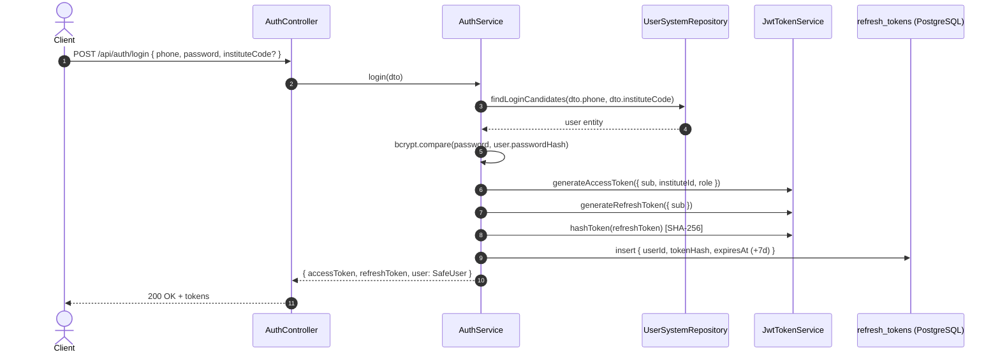

# Authentication, sessions, RBAC

> Part of the rules contract (sections 8 of the former single `role.md`). Section numbers are kept so existing `role.md §N` references still resolve. Start from `core.md`.

---

## 8. Authentication and Session Management

Authentication is built with dual JWT tokens (Access + Refresh). Refresh tokens are persisted (hashed) in the PostgreSQL `refresh_tokens` table for durability and revocation.

### 8.1 Token Specifications
* **Access Token**:
  - Purpose: Stateless authentication for every request.
  - Secret: `JWT_ACCESS_SECRET` (distinct from refresh secret).
  - Expiry: Short-lived (default `15m`).
  - Payload: `{ sub: number, instituteId: number, role: string }`.
* **Refresh Token**:
  - Purpose: Obtaining new token pairs without re-submitting credentials.
  - Secret: `JWT_REFRESH_SECRET` (distinct from access secret).
  - Expiry: Long-lived (default `7d`).
  - Payload: `{ sub: number }`.

### 8.2 Security & Revocation Invariants:
1. **Password Hashing**: Passwords MUST be hashed using `bcryptjs` with salt rounds = 12.
2. **Password Secrecy**: `passwordHash` MUST NEVER be returned in any DTO, response object, or log statement.
3. **Refresh Token Storage**: Refresh tokens are stored in the `refresh_tokens` table as SHA-256 hashes (`token_hash`, unique) with an `expires_at` (7 days). Raw tokens are never stored in plaintext. Every refresh token carries a random `jti`, so two tokens issued in the same second never collide.
4. **Token Rotation**: Refreshing tokens issues a new access token AND a new refresh token; the old row is deleted and the new hash inserted.
5. **Logout**: Calling `/api/auth/logout` deletes all `refresh_tokens` rows of the user, invalidating future refresh attempts on every device.
6. **Stateless Access Verification**: The global `JwtAuthGuard` verifies the access token signature statelessly without database hits. User existence is re-verified during refresh.

### 8.3 Role-Based Access Control (RBAC)
Role authorization is enforced at the controller and route level using the `@Roles(...)` decorator and `RolesGuard`:
* **Roles Enum (`UserRole`)**: `SUPER_ADMIN`, `INSTITUTE_ADMIN`, `REGISTRAR`, `ACCOUNTANT`, `TEACHER`, `FAMILY`, `STUDENT`. Institute endpoints use permissions (§8.6); `@Roles` stays for platform-only routes (`@Roles(SUPER_ADMIN)`).
* **Decorator (`@Roles`)**: Attached to a Controller class or route handler method (`@Roles(UserRole.SUPER_ADMIN)`).
* **`RolesGuard`**: Applied globally via `APP_GUARD` in `AuthModule` immediately after `JwtAuthGuard`. Checks whether the caller's role (`request.user.role` or `RequestContext.getRole()`) is included in the endpoint's required roles. If unauthorized, throws `ForbiddenException` (403) via `Ensure.forbidden`.
* **Public Exemption**: Routes decorated with `@Public()` automatically bypass both `JwtAuthGuard` and `RolesGuard`.

### 8.4 Multi-Institute Login
* `Institute.code` is a global, unique login code (`INSTITUTE_CODE_PATTERN`, stored upper-case; platform institute = `PLATFORM`). Generated as `INS` + 5 characters when not supplied on creation.
* Login checks the password against every account with that phone (or only the one in `instituteCode`). Exactly one match → login; several matches → `400 institute_code_required`; none → `401 invalid_credentials`.

### 8.5 Feature Flags
* `@RequireFeature(FeatureKey.X)` on a controller or route restricts it to institutes that have the feature enabled; `FeatureGuard` (global, after `RolesGuard`) throws `403 feature_disabled` otherwise.
* `GET /features` returns the caller institute's flags; super admin manages them via `GET/PUT /institutes/:instituteId/features`.

### 8.6 Permissions, Teacher Scope and Staff (D2)
* **Permission = resource + action**: `Resource` (`dashboard`, `students`, `attendance`, `fees`, `exams`, `academic`, `settings`, `staff`) × `view` / `manage`, plus `marks.enter`. `ROLE_PERMISSIONS` in `common/types/permissions.ts` is the only place that decides which role has which permission; `GET /auth/me` returns the caller's list (`permissions`), and the dashboard only reads that list.
* **Controllers** declare `@RequireResource(Resource.X)`: GET/HEAD/OPTIONS need `x.view`, every other method needs `x.manage`. `@RequirePermission(...)` on a route overrides it (any of the listed permissions), e.g. `PUT exams/:id/results` → `marks.enter`. `PermissionsGuard` is global, after `RolesGuard`; a denial is `403 permission_denied`.
* **Roles today**: admins = everything; `REGISTRAR` = view all but staff, manage students + attendance; `ACCOUNTANT` = view dashboard/students/fees/academic/settings, manage fees; `TEACHER` = view attendance/exams/academic, manage attendance, `marks.enter`.
* **Teacher scope**: a permission says WHAT a teacher may do, `TeacherScopeService` (sections module) says ON WHICH ROWS — only the section/subject pairs of `SectionSubject.teacherId`. Services call `taughtPairs()` / `taughtSectionIds()` (null = not a teacher, no filter) for lists and `assertTeachesSubject` / `assertTeachesSection` for single rows (`403 teacher_scope_*`). Any new teacher-reachable endpoint MUST apply it.
* **Staff accounts** (`/staff`, `staff.*`): roles `INSTITUTE_ADMIN` / `REGISTRAR` / `ACCOUNTANT`, password ≥ 8 (bcrypt 12). Nobody changes their own role or deactivates themselves; the institute always keeps one active admin; a role change, a password reset and a deactivation revoke the member's sessions. Deactivation is a soft delete (phone released, audit kept). The `InstituteAdmin` link follows the admin role. Teachers are created by the teachers module, not here.
* **Teacher password & reset** (`/teachers`, `academic.*`): teacher password is required on creation (minimum 8 characters, `STAFF_PASSWORD_MIN`). Password is not updatable via `PATCH /teachers/:id`; password resets are exclusively handled by `POST /teachers/:id/reset-password` using `ResetStaffPasswordDto` (bcrypt 12), which immediately logs out the teacher's active sessions via `authService.logout(userId)`.
* **Institute profile** (`/institute/profile`, `settings.*`): current institute profile (`name`, `phone`, `address`, `timezone`). Changing timezone invalidates `CacheKeys.instituteTimezone`.
* **Mobile accounts** (`/mobile-accounts`, `students.*`): family and student application accounts (`FAMILY` and `STUDENT` roles). Guardian accounts create `User` + `FamilyUser`; student accounts create `User` and link to `Student.userId`. Password reset and deactivation revoke sessions via `authService.logout`. Deactivation is a soft delete releasing the phone.

---
