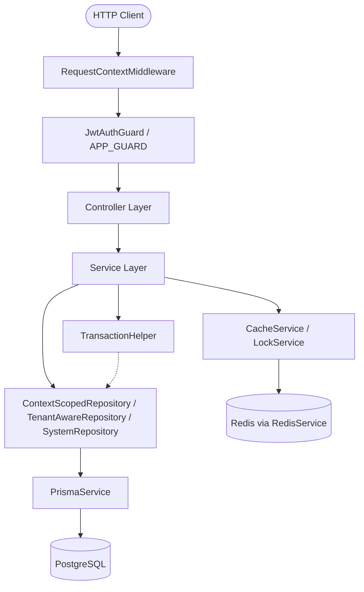
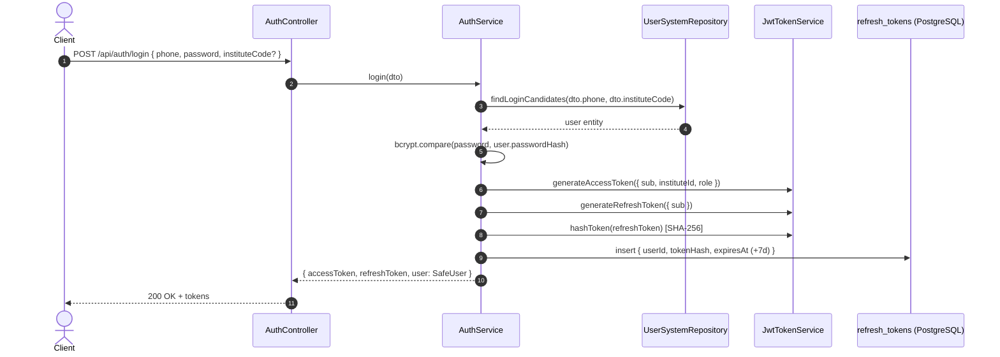

# Backend Architectural Rules, Coding Conventions, and System Constraints (`role.md`)

> **Document Status**: Authoritative Engineering Contract  
> **Target Audience**: AI Agents, Backend Developers, and System Architects  
> **Project**: SaaS Education Platform Backend (`institute-platform-backend`)  
> **Stack**: NestJS 12, TypeScript 6, Prisma ORM 7 (`@prisma/adapter-pg`), PostgreSQL, Redis (`ioredis`, BullMQ), JWT  

---

## 1. Architectural Overview and Layer Responsibilities

The backend follows a strict unidirectional, layered architectural flow:

```text
HTTP Request
    ↓
RequestContextMiddleware (AsyncLocalStorage initialization)
    ↓
JwtAuthGuard (Authentication & Context Enrichment)
    ↓
Controller (HTTP Binding, Validation, & Response Mapping)
    ↓
Service (Domain Business Logic & Orchestration)
    ↓
Repository (Data Access, Isolation, & Query Encapsulation)
    ↓
Prisma ORM (@prisma/adapter-pg)
    ↓
PostgreSQL Database
```

Each layer has strictly defined boundaries and invariants.



### 1.1 Controllers (`src/modules/<feature>/<feature>.controller.ts`)

Controllers are the HTTP boundary adapters.

#### Controllers MUST:
* Remain thin and focused exclusively on HTTP concerns (routing, status codes, headers, parameter extraction).
* Validate and parse incoming payloads via NestJS DTOs.
* Extract authenticated caller information exclusively using `@CurrentUser()` and `@CurrentInstituteId()` decorators.
* Mark unauthenticated endpoints explicitly with the `@Public()` decorator.
* Delegate all business actions to domain services and return service results.
* Use explicit HTTP status code decorators (e.g., `@HttpCode(HttpStatus.OK)`) for non-201 `POST` endpoints.

#### Controllers MUST NOT:
* Access `PrismaService` or execute database queries directly.
* Contain business logic, calculation, or domain validation rules.
* Implement manual tenant filtering or cross-tenant validation.
* Read or write directly to `AsyncLocalStorage` (`RequestContext`).
* Instantiate services or repositories using `new`.

---

### 1.2 Services (`src/modules/<feature>/<feature>.service.ts`)

Services are the sole orchestrators of business logic and domain invariants.

#### Services MUST:
* Contain all domain validation, state transitions, calculations, and business workflows.
* Perform assertions and validation using `Ensure` and `ErrorMessages`.
* Coordinate between domain repositories and infrastructure services (e.g., `CacheService`, `LockService`, `JwtTokenService`) — never `RedisService` directly (§14.2).
* Execute multi-step atomic operations using `TransactionHelper.executeInTransaction()`.
* Sanitize and map internal entities to safe output structures (e.g., stripping `passwordHash`).
* Reuse existing domain services rather than duplicating queries or business logic.

#### Services MUST NOT:
* Depend on Express `Request` or `Response` objects.
* Execute direct Prisma queries when a repository method exists or should exist.
* Duplicate business validation logic that is already implemented in another domain service.
* Throw raw `new Error(...)` for predictable domain/validation errors (use `Ensure` or NestJS HTTP exceptions).

---

### 1.3 Repositories (`src/modules/<feature>/<feature>.repository.ts`)

Repositories own all data persistence and retrieval logic.

#### Repositories MUST:
* Extend `ContextScopedRepository<T>` for all entities scoped to operational dimensions (`branchId` and/or `academicYearId`), configuring `branchKey` and/or `yearKey`.
* Extend `TenantAwareRepository<T>` for all general institute-wide database models (`instituteId`).
* Extend `SystemRepository<T>` ONLY WHEN explicit cross-tenant access is required by system architecture (e.g., authentication lookup, super-admin maintenance).
* Encapsulate complex Prisma query filters, nested includes, and aggregations.
* Automatically leverage `this.client` to support seamless inclusion inside interactive Prisma transactions.
* Expose intention-revealing, domain-specific query methods (e.g., `findByPhone`, `findByIdWithInstitute`).

#### Repositories MUST NOT:
* Contain business rule validation (business validation belongs in Services).
* Depend on Controllers, HTTP Request/Response objects, or presentation DTOs.
* Accept manual `instituteId` arguments when extending `TenantAwareRepository` or `ContextScopedRepository` (resolved from context).
* Bypass tenant or operational context isolation filters.

---

## 2. Request Context (`AsyncLocalStorage`)

Request context isolation is implemented in `src/context/request-context.ts` using Node.js `AsyncLocalStorage`.

```text
Incoming Request (HTTP Headers: Authorization, Accept-Language, X-Client-Type, X-Branch-Id, X-Academic-Year-Id)
       ↓
RequestContextMiddleware
  - Initializes context: { userId: 0, instituteId: 0, role: '', language, clientType, branchId, academicYearId }
  - Parses Accept-Language header (default: 'en')
  - Parses X-Client-Type ('web' | 'mobile')
  - Parses X-Branch-Id (positive integer)
  - Parses X-Academic-Year-Id or X-Year-Id (positive integer)
       ↓
JwtAuthGuard (validates access token → enriches userId, instituteId, role in RequestContext)
       ↓
Application Layers (Controllers, Services, Repositories read RequestContext synchronously & concurrency-safely)
```

### Context Schema (`RequestContextData`)
```ts
import { ClientType } from '../common/types/client-type.enum';

export interface RequestContextData {
  userId: number;
  instituteId: number;
  role: string;
  language: string;
  clientType?: ClientType;
  branchId?: number;
  academicYearId?: number;
}
```

### Rules & Constraints:
1. **Concurrency Safety**: Each asynchronous execution chain has an isolated store. Request data MUST NOT be stored in global variables, static class fields, or singleton service properties.
2. **Lifecycle Flow**:
   - `RequestContextMiddleware` wraps the entire downstream execution inside `RequestContext.run(...)` with initialized headers and default identity tokens.
   - `JwtAuthGuard` mutates the active store in place upon validating the JWT access token, setting `userId`, `instituteId`, and `role`.
3. **Operational Context Headers**:
   - `x-branch-id`: Injects active geographical branch scope for the request.
   - `x-academic-year-id` (or fallback `x-year-id`): Injects active academic year scope for the request.
   - `x-client-type`: Injects client platform (`web` | `mobile`).
   - `accept-language`: Injects user language preference (`ar` | `en`).
4. **Consumption Rules**:
   - Repositories MUST call `RequestContext.getInstituteId()` to retrieve the tenant ID.
   - Repositories extending `ContextScopedRepository` call `RequestContext.getBranchId()` and `RequestContext.getAcademicYearId()` for automatic dimensional filtering.
   - Centralized error formatting MUST call `RequestContext.getLanguage()` to resolve translation strings.
   - Controllers and services MUST NOT pass Express `req` through internal method signatures merely to deliver user, branch, or tenant metadata.
5. **Failure Behavior**: Calling `RequestContext.getInstituteId()` outside an authenticated request context throws an explicit error: `"Institute context is not available. This request may not be authenticated."`

---

## 3. Multi-Tenancy & Operational Scoping Architecture

The platform operates as a relational multi-tenant SaaS with a strict **Two-Tier Boundary Model**:

```text
┌─────────────────────────────────────────────────────────────────────────────────┐
│                           TIER 1: HARD SECURITY TENANT BOUNDARY                 │
│                                  Institute (Tenant)                             │
└────────────────────────────────────────┬────────────────────────────────────────┘
                                         │
        ┌────────────────────────────────┼────────────────────────────────┐
        ▼                                ▼                                ▼
┌───────────────┐                ┌───────────────┐                ┌───────────────┐
│AcademicBranch │                │ AcademicYear  │                │    Branch     │
│ (Educational) │                │  (Time Cycle) │                │ (Geographic)  │
└───────┬───────┘                └───────┬───────┘                └───────┬───────┘
        │                                │                                │
        └────────────────────────────────┼────────────────────────────────┘
                                         ▼
                                  ┌─────────────┐
                                  │   Section   │
                                  └──────┬──────┘
                                         ▼
                                  ┌─────────────┐
                                  │  Timetable  │
                                  └─────────────┘
```

### 3.1 The Two-Tier Isolation Boundary
1. **Tier 1 — Hard Security Boundary (`Institute`)**:
   - `Institute` is the authoritative, immutable tenant boundary.
   - Cross-institute data exposure is a critical security vulnerability.
   - Deterministically resolved exclusively from verified JWT token payload (`RequestContext.getInstituteId()`). Never derived from client body or route parameters.
2. **Tier 2 — Operational Dimensions (`Branch` and `AcademicYear`)**:
   - `Branch`: The physical / geographical facility or campus of the Institute.
   - `AcademicYear`: The pedagogical annual cycle (e.g., 2026-2027).
   - Resolved primarily via custom HTTP headers (`X-Branch-Id`, `X-Academic-Year-Id`) into `RequestContext` to enable zero-manual-input scoping.

### 3.2 The Comprehensive Entity Scoping Matrix

| Category | Entity | Scoping Keys | Isolation Invariants & Constraints |
| :--- | :--- | :--- | :--- |
| **Institute-Wide** *(Shared across branches & years)* | `Institute` | `id` | Root tenant container. |
| **Institute-Wide** | `Branch` | `instituteId` | Physical branch definition (`@@unique([instituteId, code])`, `@@unique([instituteId, name])`). |
| **Institute-Wide** | `AcademicYear` | `instituteId` | Academic cycle definition (`@@unique([instituteId, name])`). Dates cannot overlap. |
| **Institute-Wide** | `AcademicBranch` | `instituteId` | Educational tracks (علمي، أدبي، تأسيسي). Shared across all branches of the institute. |
| **Institute-Wide** | `Subject` | `instituteId` | Educational subjects/curriculum (`@@unique([instituteId, code])`). |
| **Institute-Wide** | `InstituteScheduleConfig` | `instituteId` | Master schedule configuration (working hours, period duration, break intervals). Single record per institute. |
| **Branch-Scoped** *(Physical & Geographic Isolation)* | `Room` | `instituteId`, `branchId` | Physical classroom or laboratory. MUST belong to a specific branch (`@@unique([instituteId, branchId, name])`). Strictly isolated per branch. |
| **Branch-Scoped** | `Teacher` | `instituteId`, `branch_teachers` | Teacher profile belongs to Institute, but teaching rights are branch-scoped via `BranchTeacher` junction. |
| **Branch & Year Scoped** *(Operational Cohort)* | `Section` | `instituteId`, `branchId`, `academicYearId` | Active student cohort. Compound uniqueness: `@@unique([instituteId, branchId, academicYearId, name])`. |
| **Branch & Year Scoped** | `Timetable` | `instituteId`, `academicYearId`, `section.branchId` | Master weekly schedule for a specific section. Inherits branch from `section.branchId`. |
| **Branch & Year Scoped** | `TimetableEntry` | `instituteId`, `timetableId`, `roomId`, `teacherId` | Timetable slot. Room MUST match section's branch; Teacher MUST be assigned to section's branch. |
| **Branch-Scoped** | `Student` | `instituteId`, `branchId` (required) | `branchId` is mandatory: resolved from DTO → header → enrolled section → default branch. |
| **Year Scoped** | `StudentEnrollment` / `EnrollmentSubject` | `instituteId`, `academicYearId` | One enrollment per student per year. `EnrollmentSubject` lists the subjects a student takes; **no rows = all section subjects**. |
| **Section Scoped** | `Exam` / `ExamResult` | `instituteId`, `sectionId`, `subjectId` | Exam is defined by section + subject (+ optional `ExamType`); `lessonId` is optional. One result per (exam, student). |
| **Branch & Year Scoped** | `Payment` / `ReceiptSequence` | `instituteId`, `branchId`, `academicYearId` | `receiptNumber` is sequential per (institute, branch, year). Payments are never deleted — they are cancelled (`status = CANCELLED`). |
| **Institute-Wide** | `InstituteFeature` | `instituteId`, `key` | Optional modules per institute (SMS, online registration, apps, accounting). No row = disabled. |
| **Institute-Wide** | `AuditLog` | `instituteId` | Written automatically for audited models (see §4.4). |

### 3.3 Core Multi-Tenancy Invariants:
1. **Never Trust Client Tenant Input**: The client request body, query parameters, or route headers MUST NEVER be trusted to determine the authoritative `instituteId`. The `instituteId` MUST always be derived from the verified JWT access token in `RequestContext`.
2. **Subdivisions are Not Tenants**: `Branch` records are subdivisions of an `Institute`, not independent tenants. All branch-level entities belong to the root `Institute`.
3. **Single Tenant Membership**: Every user record belongs to exactly one `Institute`. A phone number is unique **per institute** (`@@unique([instituteId, phone])`), so the same person may hold separate user records in several institutes. Phone uniqueness checks MUST use the tenant-scoped `UserRepository`, never a system-wide lookup.
4. **Relational Scope**: All major database entities maintain a direct or compound foreign key to `Institute` (`instituteId`) and unique compound keys (`@@unique([instituteId, id])`).
5. **No Cross-Tenant Leakage**: Unintended cross-institute data exposure is a critical security violation.

---

## 4. Repository Scoping & Tenant Enforcement

Tenant isolation and operational dimension scoping are enforced uniformly at the repository base layer, eliminating manual query filtering by developers.

### 4.1 Hierarchy: The Four Repository Tiers

```text
             ┌────────────────────────────────────┐
             │       BaseRepository<T>            │
             │   - CRUD via Prisma Delegate       │
             │   - TransactionContext awareness   │
             │   - findManyPaginated              │
             └─────────────────┬──────────────────┘
                               │
            ┌──────────────────┴──────────────────┐
            ▼                                     ▼
┌───────────────────────────────┐   ┌───────────────────────────────┐
│   TenantAwareRepository<T>    │   │     SystemRepository<T>       │
│  - Injects instituteId        │   │  - NO tenant scoping          │
│  - Scopes findById/findMany   │   │  - Auth & system maintenance  │
│  - Protects update/delete     │   │  - Explicit & auditable       │
└───────────────┬───────────────┘   └───────────────────────────────┘
                │
                ▼
┌───────────────────────────────┐
│  ContextScopedRepository<T>   │
│  - Auto-scopes branchKey      │
│  - Auto-scopes yearKey        │
│  - Supports dot-notated paths │
│  - Direct create() injection  │
└───────────────────────────────┘
```

### 4.2 Implementation Rules:
* **`TenantAwareRepository<T>`**:
  - `getInstituteId()`: Fetches the tenant ID via `RequestContext.getInstituteId()`.
  - `scopeWhere(where)`: Injects `{ ...where, instituteId: this.getInstituteId() }`.
  - `findById(id)`: Uses `findFirst({ where: { id, instituteId: this.getInstituteId() } })`.
  - `create(data)`: Automatically sets `data.instituteId = this.getInstituteId()`.
  - `update(id, data)` / `delete(id)`: Verifies tenant ownership via `findById(id)` before modifying the record. Throws `NotFoundException` if the record does not belong to the current institute.
  - `findMany`, `count`, `exists`, and `findManyPaginated`: Automatically scoped with `scopeWhere()`.
* **`ContextScopedRepository<T>`**:
  - Extends `TenantAwareRepository<T>`.
  - Configured by declaring protected members in the child repository:
    - `protected readonly branchKey?: string` (e.g. `'branchId'`, `'section.branchId'`, `'branchTeachers.some.branchId'`).
    - `protected readonly yearKey?: string` (e.g. `'academicYearId'`, `'section.academicYearId'`).
  - Supports direct column names AND nested dot notation for relational paths.
  - Automatically enriches `scopeWhere(where)` with `branchId` (from `RequestContext.getBranchId()`) and `academicYearId` (from `RequestContext.getAcademicYearId()`) if not explicitly specified in the query.
  - Automatically injects direct non-nested `branchId` and `academicYearId` into `create(data)` if present in context and omitted in payload.
* **`SystemRepository<T>`**:
  - Used ONLY for legitimate cross-tenant requirements:
    1. User login (`findLoginCandidates(phone, instituteCode?)` — all users with that phone, optionally restricted to one institute code, prior to authentication).
    2. Token refresh and account validity verification.
    3. Super-admin platform operations.
  - MUST NOT be used in feature domain modules where `TenantAwareRepository` or `ContextScopedRepository` applies.

---

### 4.3 The Cross-Branch Zero-Leakage Policy (قواعد منع تسريب البيانات الصارمة)

Under multi-branch operations, branch isolation is a critical boundary. Cross-branch data leakage (e.g., viewing, scheduling, or editing Branch A resources while Branch B is selected) is strictly forbidden.

#### Rule 1: Point-Lookup Isolation (`findByIdWithDetails`)
All single-entity fetch methods by ID in context-scoped repositories MUST use scoped filters rather than raw ID lookups:
```ts
// CORRECT (Strict Branch & Tenant Scoping):
async findByIdWithDetails(id: number) {
  return this.client.section.findFirst({
    where: this.scopeWhere({ id }), // Enforces instituteId AND active branchId
    include: { ... },
  });
}

// FORBIDDEN (Allows leaking entities from other branches):
async findByIdWithDetails(id: number) {
  return this.client.section.findFirst({
    where: { id, instituteId: this.getInstituteId() }, // Missing branch scope!
    include: { ... },
  });
}
```
*Result*: When an ID belonging to Branch A is requested with Branch B active in the header, `this.scopeWhere({ id })` yields no match (`null`), and the service correctly throws a `404 Not Found`.

#### Rule 2: Cross-Branch Mutation Protection (Update / Delete / Toggle)
Services performing updates, deletions, or status toggles MUST assert that the target entity belongs to the active branch context before proceeding:
```ts
const contextBranchId = RequestContext.getBranchId();
Ensure.custom(
  Boolean(contextBranchId && existing.branchId !== contextBranchId),
  ErrorMessages.get('section_branch_mismatch'), // or 'room_branch_mismatch'
  400,
);
```
*Result*: A user or API client authenticated in Branch B cannot mutate, deactivate, or delete records belonging to Branch A.

#### Rule 3: Timetable & Resource Branch Matching Invariants
Physical resources and personnel cannot be scheduled across branch boundaries:
1. **Room Branch Compatibility**:
   - When generating or manually adding timetable entries, the physical `Room` (`roomId`) MUST belong to the exact same branch as the section:
   ```ts
   Ensure.custom(
     room.branchId !== section.branchId,
     ErrorMessages.get('room_branch_mismatch'),
     400,
   );
   ```
   - Automated schedule solvers MUST filter available rooms strictly by `where: { branchId: section.branchId }`.
2. **Teacher Branch Assignment Compatibility**:
   - A teacher assigned to a section subject or scheduled in a timetable slot MUST be officially assigned to that branch in the `branch_teachers` table:
   ```ts
   const branchTeacherCount = await client.branchTeacher.count({
     where: {
       instituteId: this.getInstituteId(),
       teacherId: dto.teacherId,
       branchId: section.branchId,
     },
   });
   Ensure.custom(
     branchTeacherCount === 0,
     ErrorMessages.get('teacher_not_assigned_to_branch'),
     400,
   );
   ```

#### Rule 4: Prisma Transaction Client Consistency
Inside transactional workflows, repositories MUST access the transactional client via `this.client` or repository methods (`this.findOne`, `this.findMany`) and NEVER invoke `this.prisma` directly. Bypassing `this.client` breaks atomic ACID rollbacks.

### 4.4 Soft Delete & Audit (repository flags)

Configured by the child repository, in the same style as `branchKey` / `yearKey`:

```ts
export class SubjectRepository extends TenantAwareRepository<Subject> {
  protected override readonly softDelete = true;                  // model has deletedAt
  protected override readonly softDeleteReleaseFields = ['name']; // unique columns to free
  protected override readonly audited = true;                     // model has createdById/updatedById
  // protected override readonly actorColumns = false;            // audited model WITHOUT those columns (users)
}
```

* **`softDelete`**: `delete()` sets `deletedAt` instead of removing the row; `scopeWhere()`, `findById()` and every base read skip deleted rows. Custom queries that bypass `scopeWhere()` (e.g. `findRawById`) MUST wrap their `where` with `this.notDeleted(...)`. Relation includes of soft-deletable children SHOULD filter `deletedAt: null`.
* **`softDeleteReleaseFields`**: string columns covered by a unique constraint are suffixed with `__deleted_<id>` on soft delete so the value can be reused by a new record.
* **`audited`**: `create()` stamps `createdById`/`updatedById` from `RequestContext`; `update()` / `delete()` write an `AuditLog` row (`before` snapshot + `changes`) in the same transaction. Keys matching `/password/i` are never written to the log. A model that must be audited but has no actor columns (`User`, via `StaffRepository`) sets `actorColumns = false`: AuditLog rows are written, column stamping is skipped.
* Soft-delete models today: `Student`, `Family`, `Teacher`, `Section`, `Subject`, `Room`, `User` (`phone` released). Audited: the same minus `User`. Financial and academic records (`StudentSubscription`, `Installment`, `Payment`, `ExamResult`, `LessonAttendance`, `Exam`, `StudentEnrollment`, `EnrollmentSubject`) already have the actor columns and MUST set `audited = true` when their repository is created.
* Repositories without the flags keep the original hard-delete behaviour.

---

## 5. Prisma ORM Conventions

The project uses Prisma 7 with the `@prisma/adapter-pg` driver adapter.

### Prisma Rules:
1. **Access via Repositories Only**: `PrismaService` MUST NOT be injected into Controllers. It SHOULD be accessed exclusively via Repositories and `TransactionHelper`.
2. **Preserve Generated Types**: Use Prisma's generated types (e.g., `User`, `Institute`, `Prisma.UserWhereInput`) for entity references and query structures. Do not substitute them with `any` or loose custom interfaces.
3. **Lifecycle Management**: `PrismaService` extends `PrismaClient` and implements `OnModuleInit` (`$connect()`) and `OnModuleDestroy` (`$disconnect()`).
4. **Connection Pool**: Database connection configuration is supplied via `DATABASE_URL` through `ConfigService` in `PrismaService`.
5. **Schema as Single Source of Truth**: The Prisma schema (`prisma/schema.prisma`) defines the authoritative data model, foreign keys, cascade rules, and indexes.
6. **Migrations Only — never `db push`**: Every schema change ships as a migration in `prisma/migrations/`. Workflow:
   1. Edit `schema.prisma`.
   2. Generate SQL: `npx prisma migrate diff --from-config-datasource --to-schema prisma/schema.prisma --script -o prisma/migrations/<timestamp>_<name>/migration.sql` (or `npm run prisma:migrate:create` in an interactive terminal).
   3. Review the SQL. Replace Prisma's `DROP COLUMN` + `ADD COLUMN` for type changes with `ALTER COLUMN ... TYPE ... USING (...)` and add backfills so existing data is preserved.
   4. Apply with `npm run prisma:deploy`, then `npm run prisma:generate`.
7. **Enums for fixed value sets**: Statuses, types and methods (`Gender`, `EnrollmentStatus`, `PaymentMethod`, `AttendanceStatus`, `Currency`, …) are Prisma enums; DTOs validate them with `@IsEnum(...)`. Free `String` columns are not used for closed sets.
8. **Money**: monetary amounts use `Decimal(18, 2)`; exchange rates `Decimal(18, 4)`. Supported currencies: `SYP`, `USD`.
9. **Week start**: day-of-week values follow JS (0 = Sunday … 6 = Saturday); the institute week starts on **Saturday** (default working days `[6, 0, 1, 2, 3, 4]`).
10. **Institute time zone**: instants (`DateTime`) are stored in UTC; calendar dates (attendance day, due dates, exam dates) are `@db.Date` in the **institute's** local calendar (`Institute.timezone`, default `Asia/Damascus`). Domain code MUST get "today" / "now" from `InstituteClockService` (`today()`, `localParts()`), never from `new Date()` date math. Pure helpers live in `src/common/time/timezone.ts`.

---

## 6. Centralized Error Handling

Error handling is standardized around the `Ensure` validation utility, the `ErrorMessages` registry, and the `GlobalExceptionFilter`.

```text
Service Layer (Ensure.exists / Ensure.required / Ensure.unauthorized)
       ↓ Throws NestJS HttpException (NotFoundException, BadRequestException, etc.)
GlobalExceptionFilter (Catches exception)
       ↓ Formats normalized JSON response
Client Response
```

### 6.1 `Ensure` Guard Methods (`src/common/errors/ensure.ts`)

| Method | Behavior | HTTP Status |
| :--- | :--- | :--- |
| `Ensure.exists(val, resource)` | Asserts `val` is not null/undefined; throws with `{resource} not found` | `404 Not Found` |
| `Ensure.required(val, field)` | Asserts `val` is not null/undefined/empty string; throws with `{field} is required` | `400 Bad Request` |
| `Ensure.alreadyExists(val, resource)` | Asserts `val` is null/undefined; throws if resource exists | `409 Conflict` |
| `Ensure.unauthorized(cond, msg?)` | Throws if `cond === true` | `401 Unauthorized` |
| `Ensure.forbidden(cond, msg?)` | Throws if `cond === true` | `403 Forbidden` |
| `Ensure.isNumber(val, field)` | Asserts `typeof val === 'number'` and not `NaN` | `400 Bad Request` |
| `Ensure.isArray(val, field)` | Asserts `Array.isArray(val)` | `400 Bad Request` |
| `Ensure.custom(cond, msg, status)` | Throws `HttpException(msg, status)` if `cond === true` | Configurable (`400` default) |

### 6.2 Standard Error Response Payload
All errors returned by the API conform to `ErrorResponse`:
```json
{
  "statusCode": 404,
  "message": "User not found",
  "error": "NotFoundException",
  "timestamp": "2026-09-01T13:15:30.000Z",
  "path": "/api/users/99"
}
```

### Rules:
* Developers MUST NOT use `throw new Error(...)` for predictable application or domain errors.
* Unhandled non-HTTP exceptions are caught by `GlobalExceptionFilter`, logged with full stack traces, and returned as generic `500 Internal server error` responses.

---

## 7. Localization and Internationalization (i18n)

The application supports multi-language error messaging through `ErrorMessages` (`src/common/errors/error-messages.ts`).

### Language Resolution:
1. `RequestContextMiddleware` parses the HTTP `Accept-Language` header from incoming requests.
2. The language code (e.g., `'ar'`, `'en'`) is stored in `RequestContext`.
3. `ErrorMessages.get(key, params)` fetches the message in the resolved language, falling back to `'en'`.

### Rules:
* Error strings MUST NOT be hardcoded inside service logic.
* To add a new error message, register the key across all language dictionaries in `error-messages.ts`.
* Parameter placeholders use `{paramName}` syntax (e.g., `"{resource} not found"` / `"{resource} غير موجود"`).

---

## 8. Authentication and Session Management

Authentication is built with dual JWT tokens (Access + Refresh). Refresh tokens are persisted (hashed) in the PostgreSQL `refresh_tokens` table for durability and revocation.



### 8.1 Token Specifications
* **Access Token**:
  - Purpose: Stateless authentication for every request.
  - Secret: `JWT_ACCESS_SECRET` (distinct from refresh secret).
  - Expiry: Short-lived (default `15m`).
  - Payload: `{ sub: number, instituteId: number, role: string }`.
* **Refresh Token**:
  - Purpose: Obtaining new token pairs without re-submitting credentials.
  - Secret: `JWT_REFRESH_SECRET` (distinct from access secret).
  - Expiry: Long-lived (default `7d`).
  - Payload: `{ sub: number }`.

### 8.2 Security & Revocation Invariants:
1. **Password Hashing**: Passwords MUST be hashed using `bcryptjs` with salt rounds = 12.
2. **Password Secrecy**: `passwordHash` MUST NEVER be returned in any DTO, response object, or log statement.
3. **Refresh Token Storage**: Refresh tokens are stored in the `refresh_tokens` table as SHA-256 hashes (`token_hash`, unique) with an `expires_at` (7 days). Raw tokens are never stored in plaintext. Every refresh token carries a random `jti`, so two tokens issued in the same second never collide.
4. **Token Rotation**: Refreshing tokens issues a new access token AND a new refresh token; the old row is deleted and the new hash inserted.
5. **Logout**: Calling `/api/auth/logout` deletes all `refresh_tokens` rows of the user, invalidating future refresh attempts on every device.
6. **Stateless Access Verification**: The global `JwtAuthGuard` verifies the access token signature statelessly without database hits. User existence is re-verified during refresh.

### 8.3 Role-Based Access Control (RBAC)
Role authorization is enforced at the controller and route level using the `@Roles(...)` decorator and `RolesGuard`:
* **Roles Enum (`UserRole`)**: `SUPER_ADMIN`, `INSTITUTE_ADMIN`, `REGISTRAR`, `ACCOUNTANT`, `TEACHER`, `FAMILY`, `STUDENT`. Institute endpoints use permissions (§8.6); `@Roles` stays for platform-only routes (`@Roles(SUPER_ADMIN)`).
* **Decorator (`@Roles`)**: Attached to a Controller class or route handler method (`@Roles(UserRole.SUPER_ADMIN)`).
* **`RolesGuard`**: Applied globally via `APP_GUARD` in `AuthModule` immediately after `JwtAuthGuard`. Checks whether the caller's role (`request.user.role` or `RequestContext.getRole()`) is included in the endpoint's required roles. If unauthorized, throws `ForbiddenException` (403) via `Ensure.forbidden`.
* **Public Exemption**: Routes decorated with `@Public()` automatically bypass both `JwtAuthGuard` and `RolesGuard`.

### 8.4 Multi-Institute Login
* `Institute.code` is a global, unique login code (`INSTITUTE_CODE_PATTERN`, stored upper-case; platform institute = `PLATFORM`). Generated as `INS` + 5 characters when not supplied on creation.
* Login checks the password against every account with that phone (or only the one in `instituteCode`). Exactly one match → login; several matches → `400 institute_code_required`; none → `401 invalid_credentials`.

### 8.5 Feature Flags
* `@RequireFeature(FeatureKey.X)` on a controller or route restricts it to institutes that have the feature enabled; `FeatureGuard` (global, after `RolesGuard`) throws `403 feature_disabled` otherwise.
* `GET /features` returns the caller institute's flags; super admin manages them via `GET/PUT /institutes/:instituteId/features`.


### 8.6 Permissions, Teacher Scope and Staff (D2)
* **Permission = resource + action**: `Resource` (`dashboard`, `students`, `attendance`, `fees`, `exams`, `academic`, `settings`, `staff`) × `view` / `manage`, plus `marks.enter`. `ROLE_PERMISSIONS` in `common/types/permissions.ts` is the only place that decides which role has which permission; `GET /auth/me` returns the caller's list (`permissions`), and the dashboard only reads that list.
* **Controllers** declare `@RequireResource(Resource.X)`: GET/HEAD/OPTIONS need `x.view`, every other method needs `x.manage`. `@RequirePermission(...)` on a route overrides it (any of the listed permissions), e.g. `PUT exams/:id/results` → `marks.enter`. `PermissionsGuard` is global, after `RolesGuard`; a denial is `403 permission_denied`.
* **Roles today**: admins = everything; `REGISTRAR` = view all but staff, manage students + attendance; `ACCOUNTANT` = view dashboard/students/fees/academic/settings, manage fees; `TEACHER` = view attendance/exams/academic, manage attendance, `marks.enter`.
* **Teacher scope**: a permission says WHAT a teacher may do, `TeacherScopeService` (sections module) says ON WHICH ROWS — only the section/subject pairs of `SectionSubject.teacherId`. Services call `taughtPairs()` / `taughtSectionIds()` (null = not a teacher, no filter) for lists and `assertTeachesSubject` / `assertTeachesSection` for single rows (`403 teacher_scope_*`). Any new teacher-reachable endpoint MUST apply it.
* **Staff accounts** (`/staff`, `staff.*`): roles `INSTITUTE_ADMIN` / `REGISTRAR` / `ACCOUNTANT`, password ≥ 8 (bcrypt 12). Nobody changes their own role or deactivates themselves; the institute always keeps one active admin; a role change, a password reset and a deactivation revoke the member's sessions. Deactivation is a soft delete (phone released, audit kept). The `InstituteAdmin` link follows the admin role. Teachers are created by the teachers module, not here.
* **Teacher password & reset** (`/teachers`, `academic.*`): teacher password is required on creation (minimum 8 characters, `STAFF_PASSWORD_MIN`). Password is not updatable via `PATCH /teachers/:id`; password resets are exclusively handled by `POST /teachers/:id/reset-password` using `ResetStaffPasswordDto` (bcrypt 12), which immediately logs out the teacher's active sessions via `authService.logout(userId)`.

---

## 9. DTOs and API Validation

Validation is enforced at the HTTP boundary via NestJS `ValidationPipe`.

### 9.1 Global Configuration (`src/main.ts`):
```ts
app.useGlobalPipes(
  new ValidationPipe({
    whitelist: true,            // Strips any property not defined in DTO
    forbidNonWhitelisted: true,  // Throws 400 if extra properties are sent
    transform: true,            // Automatically coerces payloads to DTO class instances
    transformOptions: {
      enableImplicitConversion: false,
    },
  }),
);
```

### 9.2 DTO General Rules:
* All controller inputs (`@Body()`, `@Query()`, `@Param()`) MUST have strongly typed DTO classes decorated with `class-validator` and `class-transformer` decorators.
* DTOs MUST ONLY validate syntax, format, data types, and presence.
* Domain business rules (e.g., verifying user balance, relationship validity) MUST NOT be embedded in DTO custom validators; they belong in Services.
* Tenant identity (`instituteId`) MUST NEVER be included in Create/Update DTOs; it is always derived from authenticated JWT context.

### 9.3 Header-First Operational Scoping (Zero-Manual-Input Pattern)
To ensure smooth frontend and mobile developer experience:
1. **Optional Operational Fields in DTOs**:
   - Fields representing operational context dimensions (`branchId` and `academicYearId`) MUST be decorated with `@IsOptional()` in operational DTOs (`CreateSectionDto`, `CreateRoomDto`, query DTOs, etc.).
   - Frontend and mobile applications automatically inject these dimensions via custom HTTP headers (`X-Branch-Id`, `X-Academic-Year-Id`). Developers/forms are not required to manually send them in every request payload.
2. **Three-Tier Service Fallback Resolution**:
   - Services MUST implement hierarchical fallback resolution when binding operational dimensions:
   ```ts
   // Target Branch Resolution:
   const targetBranchId = dto.branchId ?? RequestContext.getBranchId();
   const branch = targetBranchId
     ? await this.branchRepository.findById(targetBranchId)
     : await this.branchRepository.getOrCreateDefaultBranch();

   // Target Academic Year Resolution:
   const targetYearId = dto.academicYearId ?? RequestContext.getAcademicYearId();
   const academicYear = targetYearId
     ? await this.academicYearRepository.findById(targetYearId)
     : await this.academicYearRepository.getCurrentYear();
   ```
3. **Repository Context Injection**:
   - If an operational field is omitted from a creation DTO, `ContextScopedRepository.create()` automatically injects direct column values from `RequestContext` if present.

---

## 10. Service Reuse and Domain Ownership

To prevent logic duplication and divergent business rules:

1. **Single Domain Authority**: Every domain model has an authoritative owner service (e.g., `UsersService` owns user lifecycle operations).
2. **Cross-Domain Reusability**: When feature A requires logic from feature B, feature A's service MUST inject and call feature B's service rather than duplicating queries or business rules.
3. **No Controller-to-Controller Calls**: Controllers MUST NOT call other controllers.
4. **No Repository Bypassing**: Do not duplicate a repository query in an unrelated service; expose a method on the owning repository or service.

### 10.1 Reference Data (Lookup Tables)

Simple institute-owned lists (cities, schools, buses, know-ways, student statuses, exam types) live in `src/modules/reference-data/` and are built on one generic base in `reference-data/lookup/`:

1. **Repository**: extend `LookupRepository<T>` (tenant-scoped, soft delete that releases `name`). Branch-owned lists (buses) extend `ContextScopedRepository` instead and implement the same `LookupStore<T>` contract.
2. **Service**: extend `LookupService<T, CreateDto, UpdateDto>`; it owns paging, duplicate-name checks (`lookup_name_duplicate`) and **refuses deleting an entry still in use** (`lookup_in_use`, with the usage count from `countUsage`). Override only the hooks `toData`, `validate`, `findDuplicate`.
3. **Controller**: extend `NameLookupController` (or write a thin controller with concrete DTOs when the table has extra fields).
4. **Consumers** (e.g. students) validate and resolve links through the owning services (`StudentReferencesResolver`), never by querying lookup tables directly. A bus MUST belong to the student's branch (`bus_branch_mismatch`).
5. **Student statuses**: exactly one default per institute; it cannot be deleted or un-set without choosing another (`student_status_default_locked`). New institutes get the default statuses via `StudentStatusesService.provisionDefaults`.

### 10.2 Enrollments (Students in Sections)

Enrollment logic is owned by `src/modules/enrollments/` (`EnrollmentsService`); `StudentEnrollmentRepository` (students module, **audited**) and `EnrollmentSubjectRepository` are its repositories. Pure rules live in `enrollment.rules.ts`.

1. **One enrollment per student per academic year** (DB unique). The year is read from the section, never sent by the client.
2. **Section branch = student branch.** Bulk enroll (`POST /sections/:id/enrollments`) never fails as a whole: each student is `enrolled` or `rejected` with a translated reason.
3. **Transfer** (`PATCH /enrollments/:id/transfer`): only an ACTIVE enrollment, same year and same branch. It updates `sectionId` (the audit log records the move) and drops chosen subjects the new section does not teach.
4. **Status** (`PATCH /enrollments/:id/status`): ACTIVE → WITHDRAWN (reason required) or COMPLETED; WITHDRAWN → ACTIVE. `statusReason` / `statusChangedAt` keep the last change.
5. **Subjects** (`PUT /enrollments/:id/subjects`): no rows = every section subject; a choice must come from the section plan, and a choice covering the whole plan is stored as empty.
6. **Effective subjects**: attendance, grades and fees MUST call `EnrollmentsService.getEffectiveSubjects(enrollmentId)`; never re-implement the "empty = all" rule.
7. Unassigned students are listed with `GET /students?unassignedYearId=` (no separate route that could clash with `/students/:id`).

### 10.3 Fees: Contracts, Installments and Payments

Owned by `src/modules/fees/` (`ContractsService`, `PaymentsService`, `FeesReportsService`). Pure rules live in `fees.rules.ts` and `common/money/money.ts`.

1. **Money**: compute in integer minor units (`toMinor` / `minorToDecimal`). SYP has no fractions, USD two decimals (`money_invalid_precision`). Never mix currencies in a sum; reports return one row per currency. Exchange rates are always **SYP per 1 USD**.
2. **Contract** (`StudentSubscription`): one per enrollment (`enrollmentId` unique, survives transfers). Amount and currency default to the section fee (`Section.feeCurrency`). `total = gross − discount`, discount ≤ gross.
3. **Schedule**: optional first payment = installment #1 due on `startDate`; the rest is split monthly (clamped to month length) with the **rounding remainder on the last installment**. `POST /enrollments/:id/contract/preview` returns it without saving.
4. **Editing** a contract: only the discount and installments with nothing paid. Paid / partly paid installments are kept; the rest is regenerated and numbered after them.
5. **Payment**: inside one transaction — row-lock the contract (`SubscriptionRepository.lockForUpdate`), convert to the contract currency (`appliedAmount`), allocate **FIFO by due date** (`PaymentAllocation`), refuse more than the remaining balance, take the receipt number from `ReceiptSequence` (per branch + year), update installment and contract statuses.
6. **Cancellation**: payments are never deleted. `PATCH /payments/:id/cancel` requires a reason, reverses the allocations and keeps the receipt number. Everything is audited.
7. **Overdue**: computed from the institute's today (`InstituteClock`), so reports are right even before the job runs. The `fees` queue job `mark-overdue-installments` persists `OVERDUE` (idempotent); it is fanned out per institute by the hourly `dispatch` job (`src/modules/jobs/`).
8. **Workers** are declared with `autorun: false` and started on bootstrap unless `JOBS_ENABLED=false` (tests, API-only instances), so a missing Redis never blocks the API or the test runner.
9. **Overdue Aging Summary** (`GET /fees/overdue/summary` / `GET /installments/overdue/summary`): returns overdue installments aggregated into aging buckets (`1-30`, `31-60`, `61-90`, `90+`) per currency using `FeesReportsService.getOverdueAging` and pure rules in `fees.rules.ts`.

### 10.4 Daily Attendance

Owned by `src/modules/attendance/` (`AttendanceService`, `DailyAttendanceRepository`, audited). Pure rules in `attendance.rules.ts`.

1. **One record per student per local day** (`DailyAttendance`, unique `[instituteId, studentId, date]`). `date` is always the institute-local date from `InstituteClock` / `getLocalParts`; `checkInAt` / `checkOutAt` are UTC instants.
2. **Check-in**: only for a student with an ACTIVE enrollment, only on `workingDays`, once per day, never in the future. `LATE` when after `dayStartTime + lateAfterMinutes` (schedule config, default 15), else `PRESENT`. A late arrival replaces an ABSENT / EXCUSED mark of the same day.
3. **Check-out**: only after the check-in of the same day, once.
4. **Bulk** (`POST /attendance/bulk`) never fails as a whole: `done` + `skipped` with the translated reason.
5. **Corrections** (`PATCH /attendance/:id`) are audited; changing only the check-in time recomputes PRESENT / LATE.
6. **Absence job**: the hourly dispatcher enqueues `mark-absences` per institute; after `attendanceCloseTime` (default `dayEndTime`) of a working day it inserts ABSENT for students without a record (`createMany` + `skipDuplicates`): existing records are never touched.
7. `LessonAttendance` stays in the schema for later; there is no module for it.

### 10.5 Exams and Marks

Owned by `src/modules/exams/` (`ExamsService`, `ExamRepository` / `ExamResultRepository`, both audited). Pure rules in `exams.rules.ts`.

1. **Exam**: section + one of its **plan subjects** (`exam_subject_not_in_section`), date inside the section's academic year, `0 < passMark ≤ maxMark`. Section and subject cannot change after creation.
2. **Students of an exam** = ACTIVE enrollments of the section that study the subject, from `EnrollmentsService.findStudentsTakingSubject` (same "no choice = all subjects" rule as `getEffectiveSubjects`). A student who already has a mark stays on the sheet (flagged `eligible: false`).
3. **Marks** (`PUT /exams/:id/results`): bulk upsert; the status is always computed server-side: ABSENT when flagged, PENDING without a mark, else PASSED / FAILED against `passMark`. Marks outside `[0, maxMark]` or with more than two decimals are refused.
4. Changing `passMark` / `maxMark` re-computes existing statuses; a `maxMark` below an entered mark is refused.
5. **Delete**: an exam with marks needs `?force=true` (409 `exam_has_results` otherwise); marks and exam are deleted in one transaction and audited.
6. `GET /students/:id/results` returns every mark plus the average percentage per subject.

### 10.6 Dashboard Overview (Read-Only Composition)

`src/modules/dashboard/` serves `GET /dashboard/overview`: every number of the home page in one call, for the header branch and the header (or current) academic year, with local dates from `InstituteClock`.

1. **Each domain computes its own numbers** through an overview method on its owning service: `StudentsService.getOverview`, `EnrollmentsService.getActiveStudentSections`, `AttendanceService.getOverview`, `FeesReportsService.getOverview`, `ExamsService.getOverview`. `DashboardService` only composes them (plus the sections list and the teachers count).
2. **No manual SQL** (§18.9): aggregates use Prisma `groupBy` / `count` / `findMany` with `select`; the repositories own those queries (`countByDayAndStatus`, `sumOpenBySubscription`, `averageByExam`, ...).
3. **Pure joins and maths** live in rules files with tests: `attendanceRate`, `lastWorkingDays`, `attendanceSeries` (attendance), `lastMonthKeys`, `collectionsByMonth` (fees), `weightedAveragePercent` (exams), `todayAttendance`, `sectionRows` (dashboard).
4. **Money is never mixed**: finance numbers are one row per currency. Collections are in the payment currency; balance and overdue are in the contract currency.
5. Without an academic year the endpoint returns zeros and `academicYear: null` (it never creates a year).
6. Calendar shifts use `shiftLocalDate` from `common/time/timezone.ts`; do not add private date helpers.

### 10.7 Reports and Printing (Read-Only Composition, D3)

`src/modules/reports/` serves every report of the platform. It owns no table.

1. **One catalog**: `report-catalog.ts` defines each report ONCE (key, category, title, permission, parameters, `verifiable`). `GET /reports/catalog` returns the entries the caller's role may open; the dashboard builds its reports center, parameter forms and contextual menus from it. A new report = a catalog entry + a builder (the `ReportsService` spec fails if a key has no builder).
2. **One document shape**: builders return a `ReportDocument` (`document/report-document.ts`): title, meta, orientation and typed blocks (`stats`, `fields`, `table`, `grid`, `bars`, `note`, `signatures`). Table cells are typed by their column `kind`; money cells carry their currency and totals are one row per currency (never mixed). The dashboard renders it (screen + print) and `ReportExcelService` writes the same document to `.xlsx` (RTL sheet, money / date / percent formats): `GET /reports/:key` and `GET /reports/:key/excel`.
3. **Composition only**: builders (`builders/*.reports.ts`, one class per category) call the owning domain services; the queries live in the domain repositories (`FeesReportDataService`, `AttendanceService.getRecordsBetween`, `ExamsService.getExamsWithResults`, `EnrollmentsService.getYearEnrollments`, `TimetablesService.getEntriesForReport`, `StaffActivityService`). Pure maths (periods, aging buckets, ranking, distributions, working days) lives in `reports.rules.ts` with tests.
4. **Security**: `ReportsService` checks the report permission (403), required parameters (400 `report_param_required`) and the teacher scope of a `sectionId`; domain calls keep their own scope checks (exam sheets, student history). Reports follow the header branch / year (else the current year) and the institute-local dates. Synchronous reports are capped at `REPORT_ROW_LIMIT` (5000) rows; bigger exports wait for background jobs.
5. **Verification**: verifiable documents (student statement, transcript, exam sheet) and receipts get a document number and an HMAC-signed token (`ReportVerificationService`, secret `REPORT_SIGNING_SECRET`, falls back to `JWT_ACCESS_SECRET`). The QR opens the public `/verify/:token` page, which shows the institute, the number and the signed summary lines; any change to the token makes it invalid. Tokens hold no sensitive data (a name and short lines only).
6. **Direct Document Excel Rendering** (`POST /reports/render/excel`): accepts a full `ReportDocument` via `RenderReportExcelDto` and renders an RTL `.xlsx` binary stream directly via `ReportExcelService.renderExcelBuffer`. Protected by limits: title ≤ 200 chars, ≤ 20 blocks, table rows ≤ `REPORT_ROW_LIMIT` (5000), payload ≤ 2MB. Used by the dashboard selection bar and printable modules to export custom tabular selections without creating ad-hoc exporters.

---

## 11. Pagination Standards

All paginated endpoints MUST conform to standard query and response structures.

### 11.1 Query Parameters (`PaginationQueryDto`)
* `page`: 1-based page index (`@IsPositive()`, `@IsInt()`, default = `1`).
* `limit`: Items per page (`@IsPositive()`, `@IsInt()`, `@Max(100)`, default = `20`).
* `skip`: Computed property `(page - 1) * limit` for Prisma offset.

### 11.2 Response Shape (`PaginatedResult<T>`)
```ts
export interface PaginatedResult<T> {
  data: T[];
  total: number;
  page: number;
  limit: number;
  totalPages: number;
}
```

### 11.3 Implementation:
Repositories extending `BaseRepository` provide `findManyPaginated(pagination, options)` which executes data fetching and total count concurrently via `Promise.all([findMany, count])` and returns `createPaginatedResult(data, total, page, limit)`.

---

## 12. Filtering and Searching

Dynamic query filtering MUST use Prisma-compatible structures and avoid SQL injection or untyped query builders.

### 12.1 `FilterBuilder` Utility (`src/common/filters/filter-builder.ts`)
The `FilterBuilder<TWhere>` provides a fluent API for building typed Prisma `where` objects:
```ts
const where = new FilterBuilder<Prisma.UserWhereInput>()
  .contains('fullName', query.search)
  .equals('role', query.role)
  .boolean('isActive', query.isActive)
  .range('createdAt', query.fromDate, query.toDate)
  .build();
```

### Rules:
* Methods in `FilterBuilder` (`equals`, `contains`, `in`, `notIn`, `range`, `startsWith`, `endsWith`, `boolean`, `relation`, `custom`) are safe no-ops when the passed value is `undefined` or `null`.
* `contains` defaults to case-insensitive matching (`mode: 'insensitive'`).
* For complex nested queries or raw Prisma expressions, define typed Prisma where objects directly. Do NOT build ad-hoc string-based query builders.

---

## 13. Transactions and Atomicity

Multi-step database modifications that require ACID guarantees MUST use Prisma interactive transactions.

### 13.1 `TransactionHelper` & `TransactionContext` (`src/database/`)

The application integrates Prisma interactive transactions with `AsyncLocalStorage`:

```ts
await this.transactionHelper.executeInTransaction(async () => {
  // All repository operations invoked inside this scope automatically
  // execute against the active Prisma transaction client.
  const user = await this.userRepository.create({ ... });
  await this.profileRepository.create({ userId: user.id, ... });
});
```

### Rules:
* Repositories MUST access Prisma via `this.client`, which resolves `TransactionContext.get() ?? this.prisma`.
* Developers MUST NOT pass transaction client objects (`tx`) manually through service and repository method signatures.
* Never simulate transactions manually. If an unhandled error occurs within `executeInTransaction`, the entire transaction is rolled back automatically by Prisma.

---

## 14. Module Structure and Directory Conventions

Modules are organized by functional domain under `src/modules/`:

```text
src/
├── common/                     # Cross-cutting utilities & infrastructure
│   ├── decorators/             # Parameter & method decorators (@CurrentUser, @Roles, @Public)
│   ├── errors/                 # Ensure, ErrorMessages, GlobalExceptionFilter
│   ├── filters/                # FilterBuilder
│   ├── pagination/             # PaginationQueryDto, PaginatedResult
│   └── types/                  # AuthenticatedUser, UserRole enum, common interfaces
├── context/                    # RequestContext (AsyncLocalStorage) & middleware
├── database/                   # PrismaService, Base/Tenant/System Repositories, Transactions
└── modules/                    # Feature domain modules
    ├── auth/                   # Authentication module
    │   ├── dto/                # LoginDto, RefreshTokenDto, AuthResponse DTOs
    │   ├── guards/             # JwtAuthGuard, RolesGuard
    │   ├── auth.controller.ts
    │   ├── auth.service.ts
    │   ├── jwt-token.service.ts
    │   └── auth.module.ts
    ├── institutes/             # Super Admin Institute management module
    │   ├── dto/                # CreateInstituteDto, InstituteResponse DTOs
    │   ├── institute.repository.ts
    │   ├── institutes.controller.ts
    │   ├── institutes.service.ts
    │   └── institutes.module.ts
    └── users/                  # User management module
        ├── user.repository.ts          # Tenant-scoped repository
        ├── user-system.repository.ts   # System-level repository (cross-tenant)
        └── users.module.ts
```

### Future Module Creation Rules:
When creating a new domain feature (e.g., `students`, `sections`, `finances`):
1. Place the module in `src/modules/<feature_name>/`.
2. Include `<feature>.controller.ts`, `<feature>.service.ts`, `<feature>.repository.ts`, `<feature>.module.ts`, and a `dto/` directory.
3. Import `PrismaModule` (or register required repositories) and register the module in `src/app.module.ts`.

---

### 14.1 Platform Infrastructure Modules
* **Storage** (`modules/storage`): `StorageService` is the only entry point for files. Keys are always `institutes/<instituteId>/<category>/<uuid>.<ext>` (built from `RequestContext`, never from client input). Drivers implement `StorageDriver` and are selected in `StorageModule` via the `STORAGE_DRIVER` token; only the `local` driver (`STORAGE_LOCAL_DIR`) exists today. Upload: `POST /files` (multipart `file` + `category`); download: `GET /files/:category/:fileName` (same institute only). Allowed: JPG, PNG, WEBP, PDF up to 5 MB.
* **API docs**: Swagger UI at `/<API_PREFIX>/docs` outside production. DTO schemas come from the `@nestjs/swagger` CLI plugin (`nest-cli.json`) — no manual decorators required.
* **Background jobs**: BullMQ via `QueueModule` — see §14.2. Do not add ad-hoc in-process schedulers (`setInterval`, cron libraries).

### 14.2 Redis Infrastructure (`src/infrastructure/`)

Redis is treated like Prisma: **one module owns the connection, purpose-specific services sit on top, and domain code only sees those services.**

```text
Domain services
     │ use only
     ▼
CacheService / SystemCacheService   LockService   RateLimitGuard   TenantJobProcessor
     │                                  │              │                │
     └──────────── RedisService (src/infrastructure/redis) ─────────────┘
```

| Module | Responsibility | Failure policy |
| :--- | :--- | :--- |
| `RedisModule` (global) | The ONLY owner of the ioredis connection (`REDIS_URL`, `REDIS_KEY_PREFIX`). Exposes `key(...)`, `ping()`, `connectionOptions()` | Startup without Redis logs an error and continues |
| `CacheModule` (global) | `CacheService` (tenant) / `SystemCacheService` (platform & super-admin invalidation) | **Fail-open**: store errors are logged and the loader (DB) result is returned |
| `RateLimitModule` | Global `RateLimitGuard` (registered **before** `AuthModule`): `default` policy per IP on every route; `@LoginRateLimit('phone')` adds a per IP + phone policy. Limits from `THROTTLE_*` env. 429 + `Retry-After` | **Fail-open** |
| `LockModule` (global) | `LockService.withLock(LockKeys.x, args, fn)`: institute-scoped mutual exclusion (SET NX PX + token release) | **Fail-closed**: held → 409 `operation_in_progress`; Redis down → 503 `service_unavailable`. Never runs `fn` without the lock |
| `QueueModule` | BullMQ connection and defaults (3 attempts, exponential backoff, failed jobs kept) | **Fail-closed** |
| `HealthModule` | `GET /health` (Public): postgres / redis status | — |

#### Rules
1. **No `import ioredis` (or `bullmq` connections) outside `src/infrastructure/`.** Domain code never touches `RedisService.client`.
2. **Cache keys live in `cache-keys.ts`, lock names in `lock-keys.ts`** (central registries, like `ErrorMessages`). Each cache key has a mandatory TTL; each lock a safety TTL. No ad-hoc key strings.
3. **Tenant isolation**: `CacheService` and `LockService` scope keys to `RequestContext.getInstituteId()` automatically (`t:{instituteId}:…`). The tenant is never passed as an argument. Only `SystemCacheService` may address another institute, and only for super-admin mutations (mirrors `SystemRepository`).
4. **Single domain ownership**: only the service that owns the data caches it, and it MUST invalidate after every mutation of that data (`del` / `delForInstitute`). Whole-institute invalidation bumps a version counter. `KEYS` / `SCAN` are forbidden.
5. **Cached values are JSON-safe DTOs** (no Prisma `Decimal` / `Date` instances); never cache credentials or tokens.
6. **Background jobs**:
   - Job data is built with `tenantJobData(payload)`, which attaches `instituteId` / `userId` from `RequestContext`.
   - Every worker extends `TenantJobProcessor`, which rebuilds `RequestContext` (role `SYSTEM`) before `handle()` and rejects jobs without a tenant.
   - Queue names live in a central `queue-names.ts` (created with the first queue).
   - Jobs must be idempotent (they may be retried).
7. **What does NOT go to Redis**: refresh tokens (`refresh_tokens` table) and receipt numbers (`ReceiptSequence`, same DB transaction as the payment).
8. **Tests**: unit tests use `InMemoryCacheStore` / mocked clients and never need a running Redis. Locally Redis runs with `docker compose up -d` (`docker-compose.yml`).

---

## 15. Dependency Injection and IoC

1. **NestJS DI Exclusively**: All services, repositories, helpers, and guards MUST be decorated with `@Injectable()` and managed by NestJS IoC container.
2. **No Manual Instantiation**: Never use `new ServiceClass()` or `new RepositoryClass()` inside application code.
3. **Module Exports**: If a service or repository is required by another module, it MUST be exported in its declaring module and the declaring module imported into the consumer module.
4. **Avoid Circular Dependencies**: Design service hierarchies to prevent circular dependencies. Use `forwardRef()` only as an exceptional last resort.

---

## 16. Configuration and Secrets Management

1. **Environment Variables**: All environment-dependent values MUST be retrieved using `@nestjs/config` (`ConfigService`) or typed config abstractions.
2. **Never Hardcode Secrets**:
   - Database credentials (`DATABASE_URL`)
   - JWT secrets (`JWT_ACCESS_SECRET`, `JWT_REFRESH_SECRET`)
   - Redis connection (`REDIS_URL`, may include the password)
   - API keys and tokens
3. **Strict Validation**: Critical configurations MUST use `configService.getOrThrow<string>('KEY')` on startup to fail fast if variables are missing.

---

## 17. Relational Database Rules

The Prisma schema (`prisma/schema.prisma`) represents the educational institute domain model.

### Key Relational Constraints:
* **Tenant Root**: `Institute` is the root.
* **Branches**: `Branch` belongs to `Institute` (`@@unique([instituteId, code])`, `@@unique([instituteId, id])`).
* **Academic Hierarchy**: `AcademicYear` -> `Section` -> `StudentEnrollment` / `Timetable` / `StudentSubscription`.
* **Pedagogical Links**: `Subject`, `Teacher`, `SectionTeacher`, `SectionSubject`, `Lesson`, `Exam`, `ExamResult`, `LessonAttendance`.
* **Financial Model** (management system only — no accounting ledger yet): `StudentSubscription` (enrollment contract: currency, exchange rate, gross/discount/total, first payment) -> `Installment` (amount, paidAmount, status) -> `Payment` (receipt number, currency, method, ACTIVE/CANCELLED).
* **Compound Keys**: Tenant-aware tables MUST maintain compound uniqueness where applicable (e.g., `@@unique([instituteId, id])`) to reinforce multi-tenant data integrity.

---

## 18. TypeScript and Code Quality Standards

* **Strict TypeScript**: Strict mode is enabled (`strict: true`, `noImplicitAny: true`).
* **No `any`**: Avoid `any`. Use generics, `unknown` with type guards, or explicit Prisma generated types.
* **Explicit Return Types**: Public service and repository methods SHOULD have explicit return types.
* **Linting & Formatting**: Code MUST pass `npm run lint` (`oxlint`) and `npm run format` (`prettier`).
* **No Compiler Suppression**: Do not use `@ts-ignore` or `@ts-nocheck` to bypass compilation or type-checking errors.

---

## 19. Mandatory AI Agent Rules

Any AI coding assistant or automated agent working on this backend MUST obey the following instructions:

1. **Read `role.md` First**: Always read and adhere to `role.md` before designing or implementing any code changes.
2. **Preserve Tenant Isolation**: NEVER bypass `TenantAwareRepository` or omit `instituteId` scoping for tenant-owned models.
3. **Enforce Operational Scoping via `ContextScopedRepository`**: For entities scoped to branches or academic years, extend `ContextScopedRepository<T>` and declare `branchKey` and/or `yearKey`.
4. **Prevent Point-Lookup Data Leakage**: Repository single-entity fetch methods (`findByIdWithDetails`) MUST use `where: this.scopeWhere({ id })` to prevent cross-branch entity leakage.
5. **Assert Branch Ownership on Mutation**: Domain services handling updates, deletions, or status toggles MUST assert that `contextBranchId && entity.branchId !== contextBranchId` throws `400 Bad Request` (`section_branch_mismatch`, `room_branch_mismatch`).
6. **Validate Cross-Entity Resource Compatibility**: When linking resources (assigning rooms to timetable slots, assigning teachers to sections), ALWAYS verify that physical rooms belong to the section's branch and teachers are assigned to that branch via `branch_teachers`.
7. **Keep Operational DTO Fields Optional**: Operational fields (`branchId`, `academicYearId`) in Create/Update/Query DTOs MUST be decorated with `@IsOptional()` to allow HTTP headers (`x-branch-id`, `x-academic-year-id`) to drive operational context cleanly.
8. **No Direct Prisma in Controllers**: Controllers MUST NOT inject or execute `PrismaService`.
9. **No Competing Patterns**: NEVER introduce a secondary pattern (e.g., TypeORM, Passport strategies, manual SQL queries, ad-hoc exceptions) when a project pattern already exists (`FilterBuilder`, `Ensure`, `JwtTokenService`, `RequestContext`).
10. **Single Domain Ownership**: NEVER duplicate business logic across modules.
11. **No Silent Refactoring**: DO NOT refactor existing working modules or change established API contracts unless specifically instructed in the task.
12. **Maintain Error Standards**: Use `Ensure` and `ErrorMessages` for domain validations and HTTP errors.
13. **Keep DTOs and Contracts Strict**: All new endpoints MUST have validated DTOs with `class-validator`.
14. **Preserve Prisma Type Safety**: Do not cast database entities to `any`.
15. **Consistency Over Preference**: Always prioritize consistency with the established codebase over external conventions or personal style.

---

## 20. Change Safety Invariant

> **Primary Engineering Mandate**:  
> A modification in one feature MUST NOT unexpectedly alter or break the behavior of unrelated features.

### Guidelines for Change Safety:
* Before modifying shared infrastructure (`src/common/`, `src/context/`, `src/database/`), inspect all consumer modules.
* Run existing automated unit and e2e test suites (`npm run test`, `npm run test:e2e`) to verify that modifications do not regress system functionality.
* Avoid global mutable state or side effects outside the request's `AsyncLocalStorage` scope.

---

## 21. Documentation and Contract Maintenance

* `role.md` is the single persistent architectural contract for the backend.
* When a new permanent architectural pattern, infrastructure service, or global convention is introduced and approved, `role.md` MUST be updated in the same pull request.
* Architectural rules MUST NOT remain isolated in ephemeral discussions or conversation histories.
